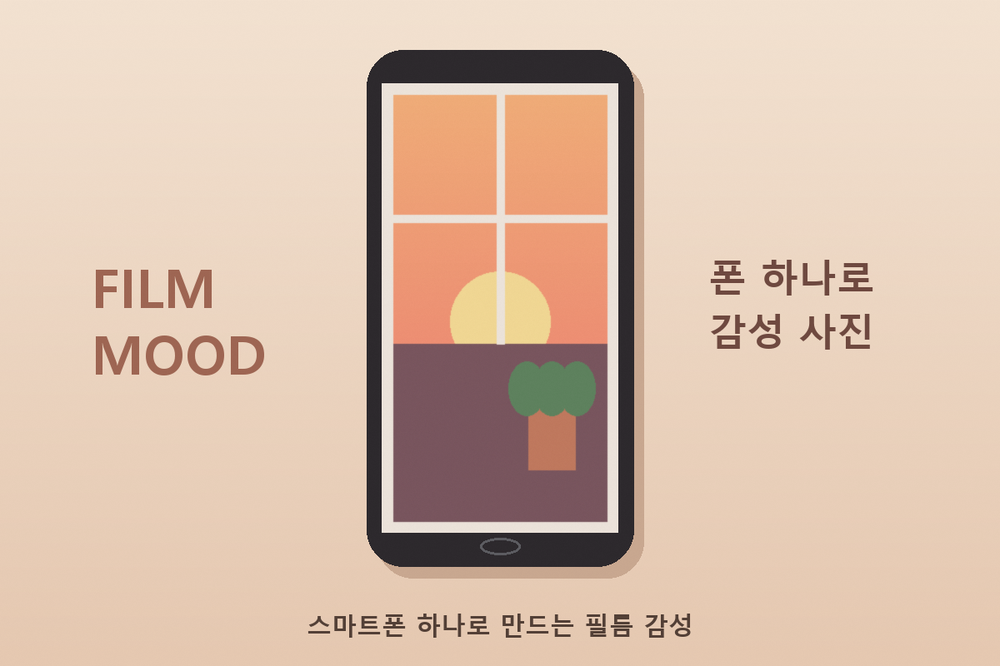
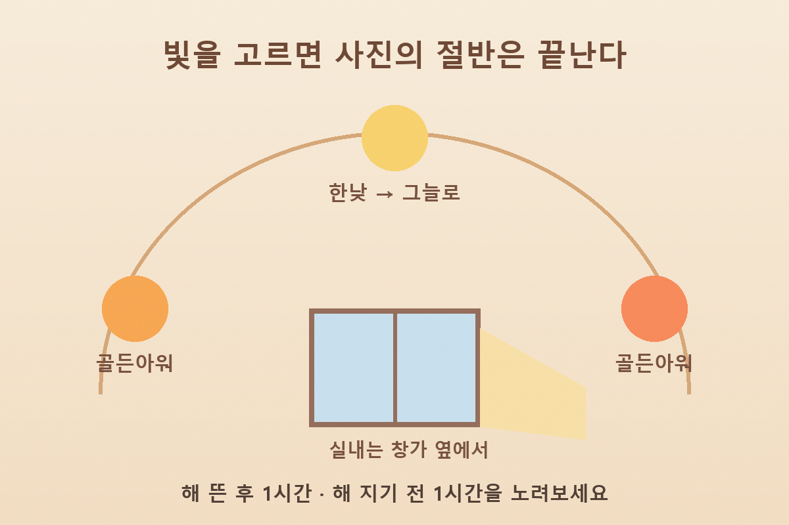
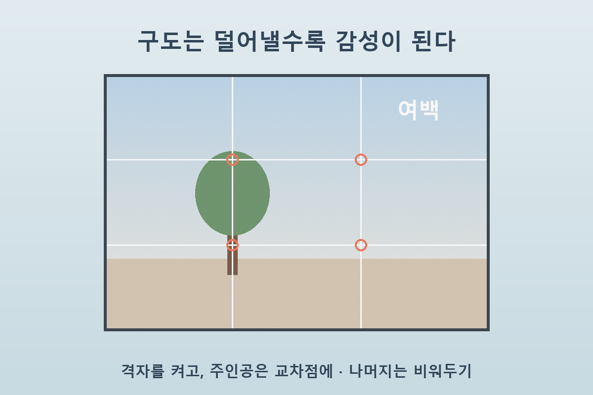
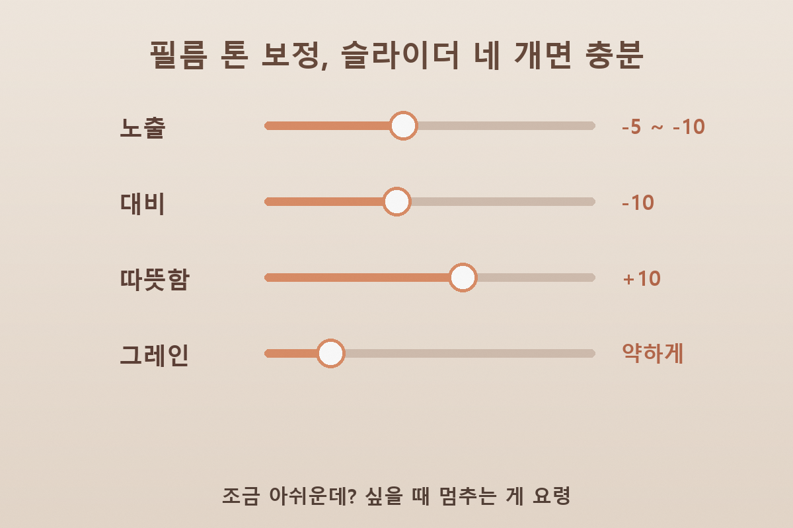

# 스마트폰 감성 사진 찍는 법, 필름 카메라 없이도 충분한 3가지 비법

<!-- 제목 후보
1. 스마트폰 감성 사진 찍는 법, 필름 카메라 없이도 충분한 3가지 비법  ← 선택
2. 스마트폰 필름 감성 사진, 빛·구도·보정만 알면 인생샷 완성
3. 감성 사진 잘 찍는 법, 요즘 유행하는 필름 톤을 폰으로 내는 방법
-->

## 서론

요즘 인스타그램이나 블로그를 보다 보면 살짝 바랜 색감, 부드러운 빛 번짐, 자글자글한 입자감이 느껴지는 '필름 감성' 사진이 정말 많이 보이죠. 중고 필름 카메라나 오래된 디카(콤팩트 디지털카메라)를 다시 찾는 분들도 늘었고요. 그런데 이런 생각, 한 번쯤 해보지 않으셨나요? "나도 저런 사진 찍고 싶은데, 카메라부터 사야 하나?" 결론부터 말씀드리면, 꼭 그럴 필요는 없어요. 지금 손에 들고 있는 스마트폰 하나로도 충분합니다. 감성 사진을 만드는 건 장비의 가격이 아니라 빛을 고르는 눈, 프레임을 정리하는 습관, 그리고 색을 다루는 작은 요령이거든요. 오늘은 누구나 바로 따라 할 수 있는 세 가지 비법을 차근차근 알려드릴게요.

## 본론

### 1. 빛을 고르면 사진의 절반은 끝난다

필름 사진 특유의 따뜻하고 부드러운 느낌은 대부분 '빛'에서 나와요. 가장 쉬운 방법은 촬영 시간을 바꾸는 거예요. 해가 뜬 직후 1시간, 해 지기 전 1시간을 '골든아워'라고 부르는데, 이때는 햇빛이 비스듬히 들어와 그림자가 길고 색이 노랗게 물들어 별다른 보정 없이도 감성적인 분위기가 납니다. 한낮에 찍어야 한다면 직사광선 아래보다는 건물 그늘이나 나무 그늘로 들어가 보세요. 얼굴과 사물에 생기던 강한 그림자가 사라지고 피부 톤이 한결 부드러워져요. 실내에서는 형광등을 끄고 창가 옆에서 찍는 것만으로도 결과가 확 달라집니다. 창문을 피사체의 옆쪽에 두면 한쪽은 밝고 한쪽은 은은하게 어두워져 입체감이 살아나요. 스마트폰 카메라 화면을 길게 눌러 초점을 고정한 뒤, 밝기 조절 바를 살짝 내려 찍으면 하늘이나 창밖이 하얗게 날아가지 않아 필름 같은 차분한 톤을 얻을 수 있어요.

### 2. 구도는 덜어낼수록 감성이 된다

감성 사진을 보면 의외로 화면이 꽉 차 있지 않아요. 비결은 '덜어내기'입니다. 먼저 스마트폰 카메라 설정에서 '격자(그리드)'를 켜 주세요. 화면이 가로세로 3등분으로 나뉘는데, 주인공을 정중앙이 아니라 선이 만나는 네 개의 점 중 하나에 두면 자연스럽게 시선이 흐르는 사진이 됩니다. 남은 공간은 하늘, 벽, 바닥 같은 단순한 배경으로 비워 두세요. 이 여백이 사진에 여유와 이야기를 만들어 줍니다. 촬영 전에는 화면 가장자리를 한 번 훑어보며 쓰레기통, 전깃줄, 지나가는 사람처럼 시선을 빼앗는 요소가 없는지 확인하는 습관을 들이면 좋아요. 시점을 바꾸는 것도 효과적이에요. 카페 테이블은 위에서 수직으로 내려다보고, 꽃이나 골목은 무릎을 굽혀 낮은 위치에서 올려다보면 평범한 장면도 새롭게 보입니다. 줌 대신 한두 걸음 직접 다가가는 것도 잊지 마세요.

### 3. 필름 톤 보정, 슬라이더 네 개면 충분하다

마지막은 보정이에요. 복잡한 앱이 없어도 스마트폰 기본 사진 편집 기능만으로 필름 톤을 낼 수 있어요. 순서는 이렇게 기억하세요. 첫째, 노출을 -5에서 -10 정도로 살짝 낮춰 색을 차분하게 가라앉힙니다. 둘째, 대비를 -10 안팎으로 줄이면 어두운 부분이 살짝 떠 보이면서 바랜 필름 같은 느낌이 생겨요. 셋째, 따뜻함(색온도)을 +10 정도 올려 노란빛을 더하면 오후 햇살 같은 분위기가 납니다. 넷째, 앱에 '그레인'이나 '노이즈' 기능이 있다면 아주 약하게 넣어 입자감을 더해 주세요. 여기에 채도를 조금 낮추면 완성입니다. 마음에 드는 값을 찾았다면 메모장에 적어 두거나 프리셋으로 저장해 두고, 다른 사진에도 똑같이 적용해 보세요. 피드 전체의 색감이 통일되면서 나만의 분위기가 생겨요. 단, 과한 보정은 오히려 촌스러워 보이니 '조금 아쉬운데?' 싶을 때 멈추는 게 요령이에요.

## 결론

오늘 이야기를 정리해 볼게요. 골든아워와 창가처럼 부드러운 빛을 고르고, 격자를 켜고 여백을 남기며 구도를 덜어내고, 노출·대비·따뜻함·그레인 네 가지로 필름 톤을 입히는 것. 이 세 가지만 기억해도 사진이 확실히 달라집니다. 다시 한번 강조하고 싶은 건, **스마트폰 하나로도 감성 사진은 충분하다**는 사실이에요. 비싼 카메라보다 중요한 건 오늘 내 주변의 빛과 장면을 조금 더 천천히 바라보는 마음이거든요. 저희 지담 스튜디오도 늘 "일상을 작품으로 남기자"는 마음으로 셔터를 누르고 있어요. 이번 주말에는 휴대폰을 들고 가까운 골목이나 창가에서 한 장 찍어 보세요. 찍은 사진이나 궁금한 점을 댓글로 남겨 주시면 저희가 직접 소소한 피드백을 드릴게요. 다음 사진 팁이 궁금하시다면 이웃추가도 잊지 말아 주세요!

---

#스마트폰사진 #감성사진 #필름감성 #폰카꿀팁 #사진잘찍는법 #골든아워 #사진구도 #사진보정 #인생샷 #일상사진 #지담스튜디오
