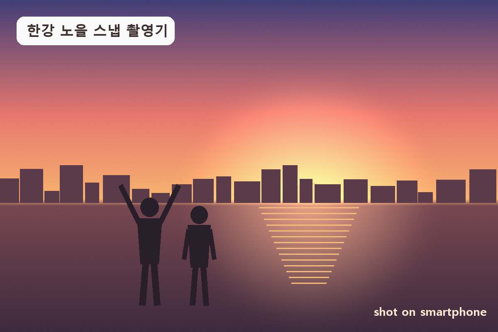
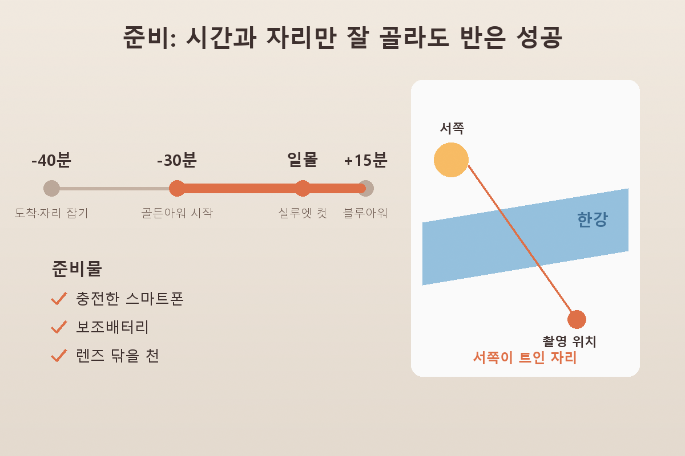
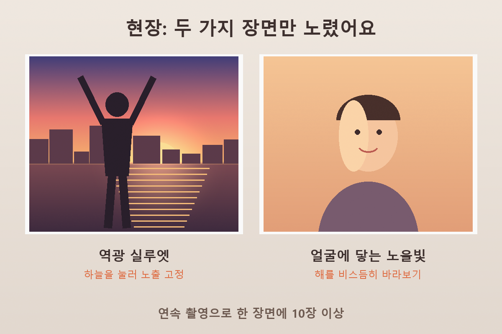
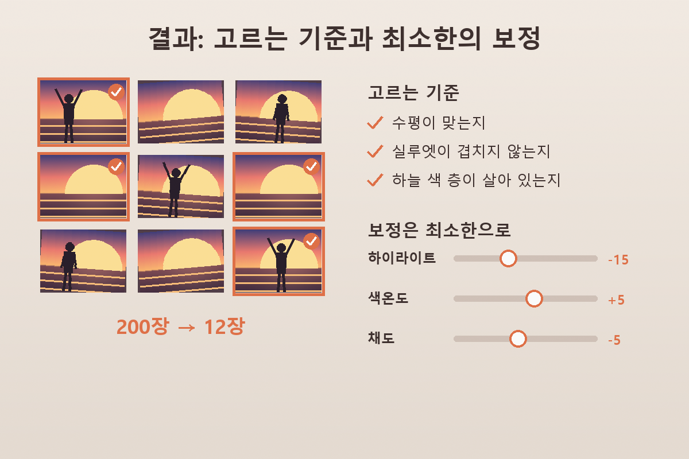

<!-- category: 촬영 후기 -->
# 한강 노을 스냅 촬영 후기, 스마트폰 하나로 찍어 본 골든아워 기록

<!-- 제목 후보
1. 한강 노을 스냅 촬영 후기, 스마트폰 하나로 찍어 본 골든아워 기록  ← 선택
2. 노을 사진 잘 찍는 법, 한강에서 스마트폰으로 직접 찍어 본 후기
3. 한강 스냅 촬영 후기, 장비 없이 폰카로 담은 노을 감성 사진
※ 장소·시간·장면은 예시입니다. 실제 촬영 내용에 맞게 고친 뒤 발행해 주세요.
-->

## 서론

요즘 SNS에서 '노을 스냅'이라는 말을 자주 보셨을 거예요. 큰 카메라와 조명 없이, 해 질 무렵의 빛만으로 자연스럽게 담아낸 사진들이죠. 그런데 막상 노을을 찍으러 나가 보면 하늘은 하얗게 날아가고 사람 얼굴은 까맣게 나와서 실망하신 적 있지 않나요? 그래서 이번에는 지담 스튜디오 팀이 직접 스마트폰 한 대만 들고 한강으로 나가 봤어요. 삼각대도, 반사판도, 별도의 렌즈도 없이 오로지 폰카와 해 지는 빛만으로 어디까지 찍을 수 있는지 확인해 보고 싶었거든요. 준비 과정부터 현장에서 건진 컷, 그리고 결과물을 고르고 보정한 과정까지, 촬영 후기를 솔직하게 정리해 볼게요.

## 본론

### 1. 준비: 시간과 자리만 잘 골라도 반은 성공

노을 스냅에서 가장 중요한 준비물은 의외로 '시간표'예요. 촬영 전날 날씨 앱에서 일몰 시각을 확인하고, 그보다 40분 먼저 도착하는 걸 목표로 잡았어요. 해가 지기 30분 전부터 지고 난 뒤 15분까지가 하늘색이 가장 빠르게 변하는 구간이라, 이 시간을 놓치면 다음 날을 기약해야 하거든요. 자리는 해가 지는 서쪽 방향이 강 건너로 트여 있는 곳을 골랐어요. 앞이 막히지 않아야 하늘이 넓게 담기고, 강물에 비친 반영까지 함께 찍을 수 있어요. 준비물은 단순했어요. 충전한 스마트폰, 보조배터리, 렌즈를 닦을 안경 닦이 하나. 촬영 전에 카메라 설정에서 격자를 켜고, 화면 비율은 블로그에 올리기 좋은 3:2와 4:3으로 바꿔 두었어요. 렌즈만 깨끗하게 닦아도 노을 빛 번짐이 훨씬 깔끔해지니 꼭 챙겨 보세요.

### 2. 현장: 역광 실루엣과 반사광, 두 가지만 노렸어요

현장에서는 욕심을 버리고 두 가지 장면만 집중해서 찍었어요. 첫 번째는 '역광 실루엣'이에요. 해를 인물 뒤에 두고, 화면에서 하늘 부분을 길게 눌러 초점과 노출을 하늘에 고정했어요. 그러면 인물은 검은 실루엣으로, 하늘은 주황빛 그대로 담기는데 이게 노을 스냅의 대표 컷이 되더라고요. 팔을 뻗거나 걸어가는 동작처럼 윤곽이 또렷한 포즈일수록 실루엣이 예뻐요. 두 번째는 '얼굴이 보이는 사진'이에요. 이번엔 반대로 인물이 해를 비스듬히 바라보게 서서, 얼굴에 노을빛이 직접 닿게 했어요. 해가 낮게 깔리는 시간이라 빛이 부드러워서 따로 반사판이 없어도 피부가 따뜻하게 물들었어요. 연속 촬영으로 한 장면에 열 장 넘게 찍어 두니, 머리카락이 바람에 날리는 자연스러운 순간을 꽤 많이 건질 수 있었답니다.

### 3. 결과: 고르는 기준과 보정은 최소한으로

이날 찍은 사진은 200장이 넘었는데요, 고르는 기준을 미리 정해 두니 금방 추려졌어요. 첫째, 수평이 맞는지. 강이 기울어지면 사진 전체가 불안해 보여요. 둘째, 실루엣이 다른 사물과 겹치지 않는지. 셋째, 하늘에 색의 층이 살아 있는지. 이 세 가지를 통과한 사진만 남기니 12장이 되었어요. 보정은 정말 조금만 했어요. 하이라이트를 -15 정도 내려 하늘의 색 층을 살리고, 색온도를 +5만 올려 노을빛을 조금 더 따뜻하게 맞췄어요. 채도는 오히려 -5로 살짝 낮췄는데, 노을 사진은 채도를 올리면 금방 인위적으로 보이더라고요. 결과적으로 장비 없이 찍은 사진이라고는 믿기지 않을 만큼 만족스러운 노을 스냅이 완성됐어요. 결국 좋은 사진은 장비보다 빛과 타이밍이 만든다는 걸 다시 한번 느꼈어요.

## 결론

이번 한강 노을 스냅 촬영을 정리해 보면, 일몰 40분 전에 서쪽이 트인 자리를 잡고, 역광 실루엣과 얼굴에 빛이 닿는 컷 두 가지에 집중하고, 기준을 정해 사진을 고른 뒤 보정은 최소한으로 하는 것이었어요. 삼각대도 조명도 없었지만 결과물은 충분히 작품 같았답니다. 그래서 다시 한번 자신 있게 말씀드릴 수 있어요. **스마트폰 하나로도 감성 사진은 충분하다**는 것을요. 지담 스튜디오는 앞으로도 이렇게 직접 나가서 찍어 보고 느낀 점을 솔직하게 공유할게요. 여러분이 가장 좋아하는 노을 명소가 있다면 댓글로 추천해 주세요. 다음 촬영 후기의 장소로 찾아가 볼게요. 새 후기를 놓치고 싶지 않다면 이웃추가도 부탁드려요!

---

#촬영후기 #노을사진 #한강노을 #노을스냅 #골든아워 #스마트폰사진 #폰카꿀팁 #실루엣사진 #감성사진 #스냅사진 #지담스튜디오
