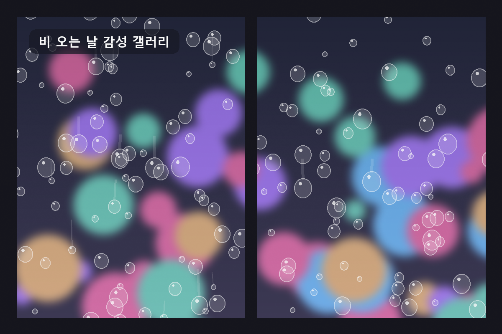
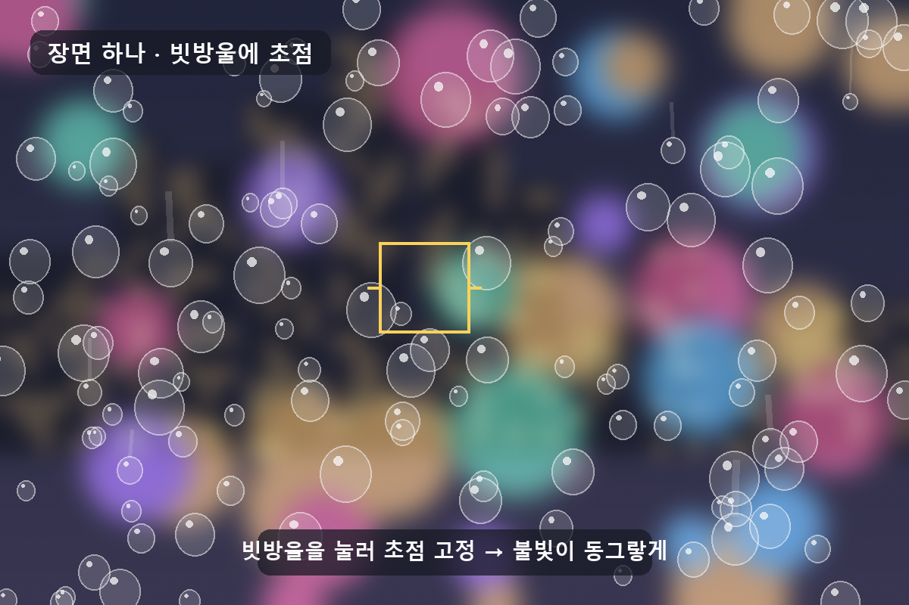
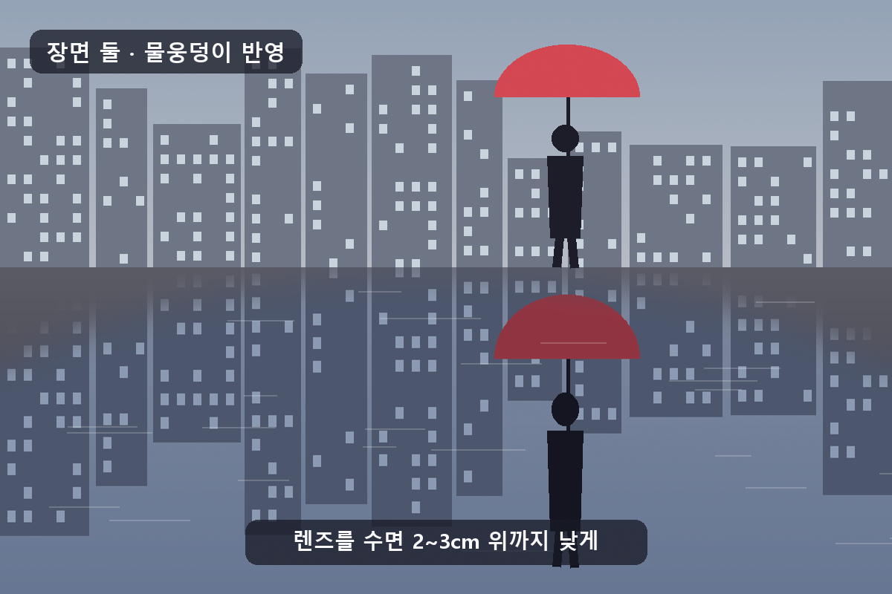
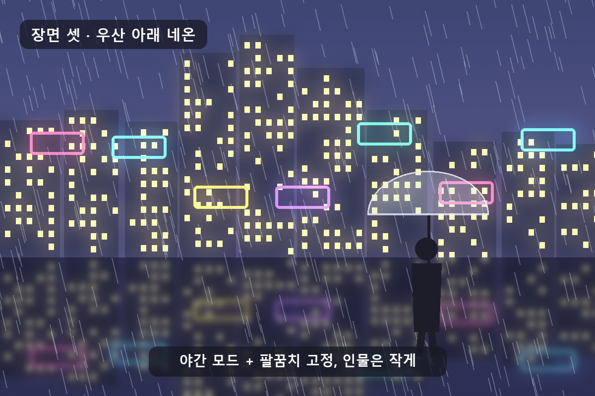

<!-- category: 감성 사진 갤러리 -->
# 비 오는 날 감성 사진, 스마트폰으로 담기 좋은 장면 3가지 갤러리

<!-- 제목 후보
1. 비 오는 날 감성 사진, 스마트폰으로 담기 좋은 장면 3가지 갤러리  ← 선택
2. 비 오는 날 사진 찍는 법, 빗방울·반영·네온으로 완성하는 감성 컷
3. 감성 사진 갤러리, 비 오는 날에만 찍을 수 있는 장면 모음
-->

## 서론

비가 오는 날이면 '오늘은 사진 찍기 글렀네' 하고 휴대폰을 주머니에 넣어 두시나요? 사실 사진을 좋아하는 사람들 사이에서는 비 오는 날을 일부러 기다린다는 말도 있어요. 요즘 SNS에서도 빗방울 맺힌 창문, 물웅덩이에 비친 도시, 우산 아래 번지는 네온 불빛 같은 '비 오는 날 감성' 사진이 꾸준히 사랑받고 있죠. 맑은 날에는 볼 수 없는 반사와 번짐, 촉촉한 색감이 평범한 골목도 영화 속 한 장면처럼 바꿔 주거든요. 이번 감성 사진 갤러리에서는 비 오는 날 스마트폰으로 담기 좋은 장면 세 가지를 골라, 장면마다 어떻게 찍으면 좋은지 함께 정리해 봤어요. 다음 비 소식이 들리면 꼭 하나씩 따라 해 보세요.

## 본론

### 1. 장면 하나: 빗방울 맺힌 창문 너머

비 오는 날 가장 쉽게 찍을 수 있으면서도 분위기가 확 사는 장면이 바로 창문이에요. 카페나 버스, 집 창가에 앉아 빗방울이 맺힌 유리를 정면으로 바라보세요. 포인트는 '초점을 바깥이 아니라 빗방울에 맞추는 것'이에요. 화면에서 가까운 빗방울을 손가락으로 눌러 초점을 고정하면, 창밖 풍경은 자연스럽게 흐려지면서 불빛이 동그랗게 번져요. 스마트폰을 유리에 10cm 정도까지 가까이 대면 빗방울이 더 크고 또렷하게 담겨요. 창밖에 신호등이나 간판, 자동차 불빛이 있으면 색색의 빛 번짐이 생겨 훨씬 감성적이에요. 실내가 밝으면 유리에 내 모습이 비칠 수 있으니, 주변 조명을 조금 낮추거나 휴대폰을 살짝 비스듬히 기울여 반사를 피해 주세요. 밝기 바를 조금 내리면 빗방울의 윤곽이 더 선명해집니다.

### 2. 장면 둘: 물웅덩이에 비친 거꾸로 된 도시

비가 그치기 직전이나 막 그친 뒤에는 길 곳곳에 물웅덩이가 생기죠. 이 물웅덩이가 훌륭한 거울이 되어 줘요. 찍는 방법은 간단해요. 스마트폰을 거꾸로 들어 렌즈를 바닥 가까이, 물웅덩이 바로 위 2~3cm 높이까지 내려 보세요. 그러면 작은 웅덩이도 화면 가득 넓은 호수처럼 보이고, 건물과 하늘이 거꾸로 비친 신기한 장면이 만들어져요. 렌즈가 낮을수록 반영이 커지니 무릎을 꿇거나 쪼그려 앉는 걸 두려워하지 마세요. 반영 속에 우산 쓴 사람이 지나가는 순간을 기다렸다가 찍으면 이야기가 있는 사진이 완성돼요. 바람이 불어 물결이 생기면 잠시 기다렸다가 수면이 잔잔해졌을 때 셔터를 누르세요. 찍은 뒤 사진을 180도 돌려 보면 또 다른 느낌의 사진이 되니 꼭 한 번 돌려 보세요.

### 3. 장면 셋: 우산 아래 번지는 밤의 네온

해가 진 뒤 비 오는 거리는 낮과 완전히 다른 얼굴을 보여 줘요. 젖은 아스팔트가 간판과 가로등 불빛을 반사해 바닥까지 색으로 물들거든요. 이 장면은 우산을 쓴 인물을 함께 넣으면 가장 감성적이에요. 투명 우산이라면 우산에 맺힌 빗방울 너머로 불빛이 번져 보여 더 좋아요. 촬영할 때는 야간 모드를 켜고, 숨을 잠깐 참은 채 1~2초 동안 휴대폰을 최대한 움직이지 않게 들고 있어야 해요. 벽이나 난간에 팔꿈치를 기대면 흔들림이 훨씬 줄어요. 인물은 불빛을 등지게 세우고 화면 한쪽에 작게 두면, 네온의 색과 빗줄기가 주인공처럼 살아나요. 보정할 때는 색온도를 -5 정도로 살짝 차갑게, 하이라이트는 -10 정도 내려 간판 글자가 하얗게 뭉개지지 않도록 해 주세요.

## 결론

이번 갤러리에서 소개한 비 오는 날 장면을 다시 정리해 볼게요. 창문 빗방울에 초점을 맞춰 바깥 불빛을 번지게 하기, 물웅덩이 바로 위로 렌즈를 내려 거꾸로 된 도시 담기, 밤거리에서 우산 쓴 인물과 네온 반사를 함께 찍기. 세 장면 모두 특별한 장비 없이 휴대폰 하나면 충분해요. 날씨가 궂다고 사진을 쉬지 마세요. **스마트폰 하나로도 감성 사진은 충분하다**는 말은 비 오는 날에 더 잘 어울리거든요. 지담 스튜디오도 비 예보가 뜨면 오히려 설레는 마음으로 카메라 앱을 켠답니다. 여러분이 찍은 비 오는 날 사진이 있다면 댓글로 어떤 장면인지 들려주세요. 다음 감성 사진 갤러리에서 소개할 장면 아이디어도 환영해요. 새 갤러리 소식을 받고 싶다면 이웃추가 부탁드려요!

---

#감성사진 #비오는날사진 #비오는날 #빗방울사진 #반영사진 #물웅덩이사진 #야경사진 #스마트폰사진 #폰카꿀팁 #감성사진갤러리 #지담스튜디오
