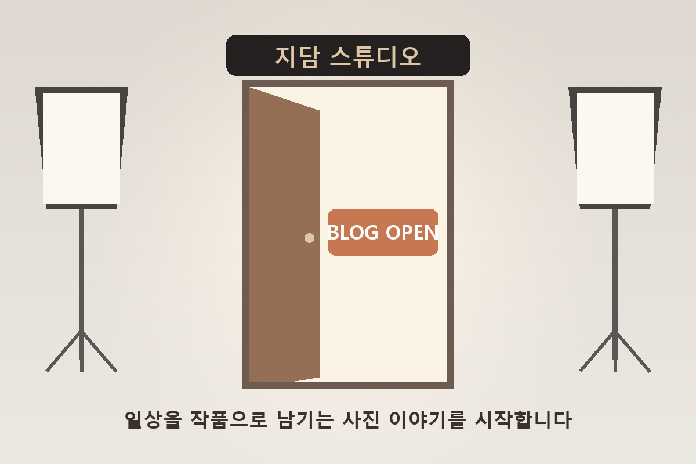
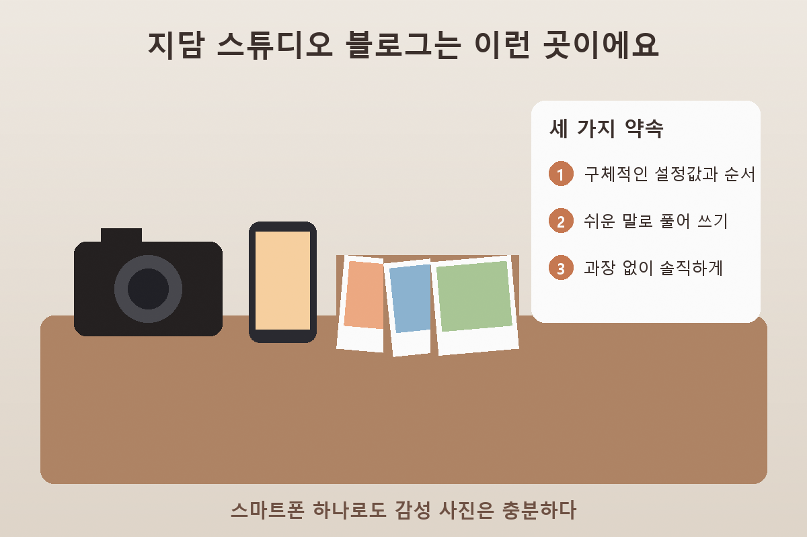
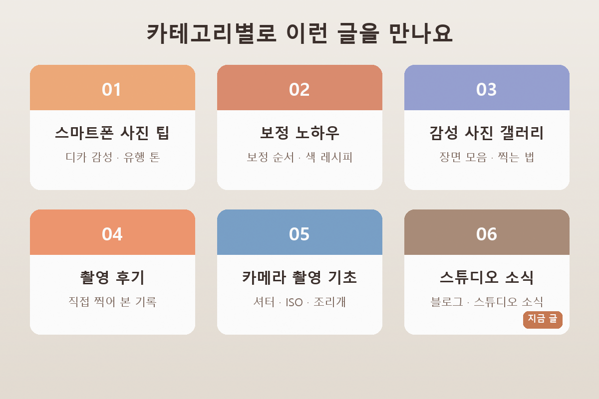
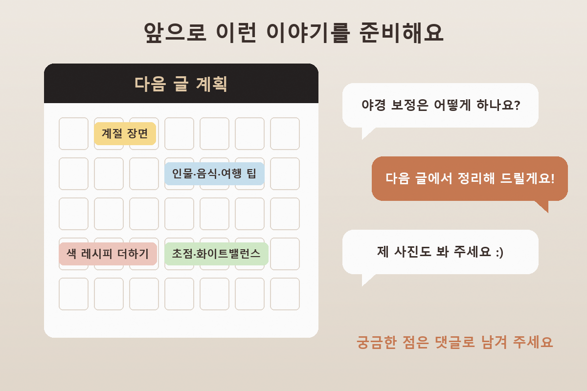

<!-- category: 스튜디오 소식 -->
# 지담 스튜디오 블로그 오픈 인사, 일상을 작품으로 남기는 사진 이야기를 시작합니다

<!-- 제목 후보
1. 지담 스튜디오 블로그 오픈 인사, 일상을 작품으로 남기는 사진 이야기를 시작합니다  ← 선택
2. 지담 스튜디오 블로그를 소개합니다, 카테고리 안내와 앞으로 나눌 이야기
3. 사진 블로그 오픈, 지담 스튜디오가 스마트폰 사진 팁을 나누는 이유
-->

## 서론

안녕하세요, 지담 스튜디오입니다. 요즘은 누구나 주머니 속 스마트폰으로 하루에도 몇 장씩 사진을 찍죠. 그런데 그렇게 찍은 사진들, 다시 꺼내 보면 마음에 드는 한 장을 찾기가 생각보다 어렵지 않으셨나요? 저희는 그 '아쉬운 한 장'을 '남기고 싶은 한 장'으로 바꾸는 방법을 나누고 싶어서 이 블로그를 열었어요. 비싼 장비나 어려운 이론보다, 오늘 당장 내 휴대폰으로 따라 해 볼 수 있는 이야기를 중심으로요. 첫 인사가 조금 늦었지만, 이 글에서는 지담 스튜디오 블로그가 어떤 곳인지, 어떤 카테고리에서 어떤 글을 만나실 수 있는지, 그리고 앞으로 어떤 이야기를 준비하고 있는지 차근차근 소개해 드릴게요.

## 본론

### 1. 지담 스튜디오 블로그는 이런 곳이에요

지담 스튜디오의 한 줄 소개는 '일상을 작품으로 남기는 사진 스튜디오'예요. 특별한 날의 기념사진만 사진이 아니라, 아침 창가의 빛이나 비 오는 날의 골목, 친구와 웃는 순간처럼 평범한 하루도 충분히 작품이 될 수 있다고 믿거든요. 그래서 이 블로그에서는 크게 세 가지를 약속드리려고 해요. 첫째, 누구나 따라 할 수 있도록 실제 설정값과 순서를 구체적으로 적을게요. 둘째, 어려운 용어는 쉬운 말로 풀어서 설명할게요. 셋째, 광고처럼 과장하지 않고 솔직하게 이야기할게요. 그리고 모든 글에 담긴 하나의 생각이 있어요. 바로 '스마트폰 하나로도 감성 사진은 충분하다'는 것이에요. 장비가 부족해서 사진을 망설였던 분들이 부담 없이 시작할 수 있는 곳이 되었으면 해요.

### 2. 카테고리별로 이런 글을 만나실 수 있어요

블로그 메뉴는 여섯 개의 카테고리로 나눠 두었어요. '스마트폰 사진 팁'에서는 디카 감성처럼 요즘 유행하는 분위기를 폰으로 내는 방법을, '보정 노하우'에서는 자르기부터 색 레시피까지 보정 순서를 다뤄요. '감성 사진 갤러리'에서는 비 오는 날처럼 특별한 장면을 모아 찍는 법과 함께 소개하고, '촬영 후기'에서는 직접 나가서 찍어 보며 느낀 점을 솔직하게 기록해요. '카메라 촬영 기초'에서는 셔터 속도, ISO, 조리개 같은 기본 개념을 스마트폰 프로 모드로 쉽게 풀어 드리고요. 마지막으로 지금 읽고 계신 '스튜디오 소식'에서는 블로그와 스튜디오의 새로운 소식을 전해 드릴게요. 이미 각 카테고리에 첫 글이 하나씩 올라가 있으니, 관심 있는 주제부터 편하게 둘러보세요.

### 3. 앞으로 이런 이야기를 준비하고 있어요

앞으로도 카테고리마다 꾸준히 새 글을 채워 갈 예정이에요. 계절이 바뀔 때마다 그 계절에만 찍을 수 있는 장면을 소개하고, 인물 사진이나 음식 사진, 여행 사진처럼 상황별로 바로 써먹을 수 있는 팁도 정리해 보려고 해요. 보정 노하우에서는 무드별 색 레시피를 더 늘리고, 카메라 촬영 기초에서는 노출 다음 단계인 초점과 화이트밸런스도 다룰 계획이에요. 무엇보다 이 블로그를 함께 만들어 가고 싶어요. 궁금한 촬영 상황이나 잘 안 풀리는 보정 고민이 있다면 댓글로 편하게 남겨 주세요. 많이 받은 질문은 따로 글로 정리해서 답해 드릴게요. 여러분이 찍은 사진 이야기를 들려주시는 것도 언제나 환영이에요.

## 결론

오늘은 지담 스튜디오 블로그를 처음으로 정식 소개해 드렸어요. 누구나 따라 할 수 있는 구체적인 팁, 쉬운 설명, 솔직한 이야기를 약속드렸고, 여섯 개 카테고리에서 각각 어떤 글을 만나실 수 있는지도 안내해 드렸어요. 앞으로의 모든 글에서 전하고 싶은 메시지는 변함없어요. **스마트폰 하나로도 감성 사진은 충분하다**는 것, 그리고 평범한 하루도 충분히 작품이 될 수 있다는 것이요. 이곳에 찾아와 주셔서 진심으로 감사드려요. 블로그에서 다뤄 줬으면 하는 주제가 있다면 댓글로 알려 주세요. 새 글 소식을 가장 먼저 받아 보고 싶다면 이웃추가도 부탁드려요. 앞으로 자주 만나요!

---

#지담스튜디오 #블로그오픈 #사진블로그 #스튜디오소식 #스마트폰사진 #사진팁 #보정노하우 #감성사진 #카메라기초 #사진공부 #일상기록
