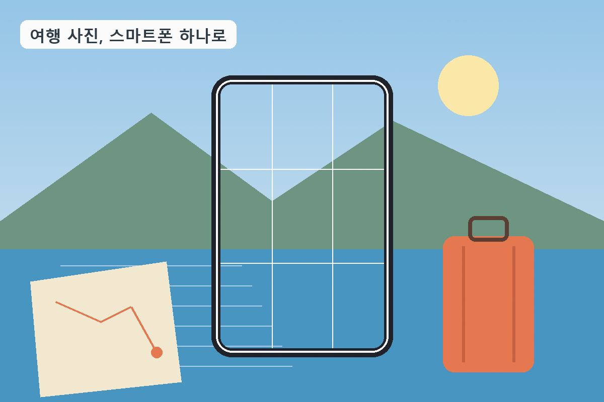
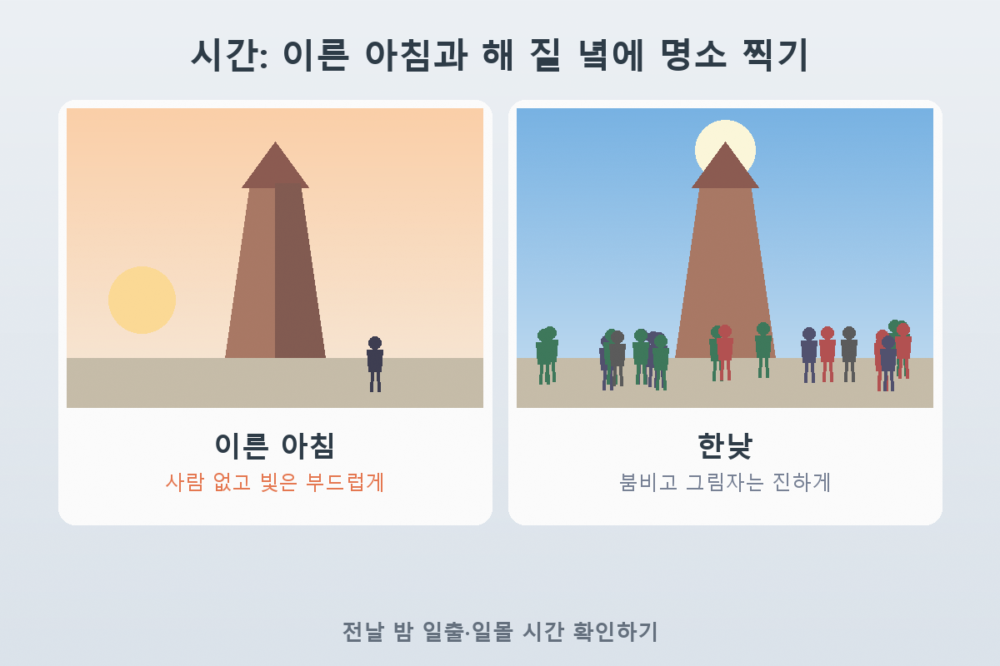
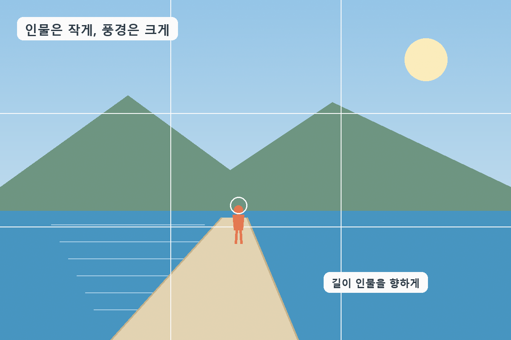
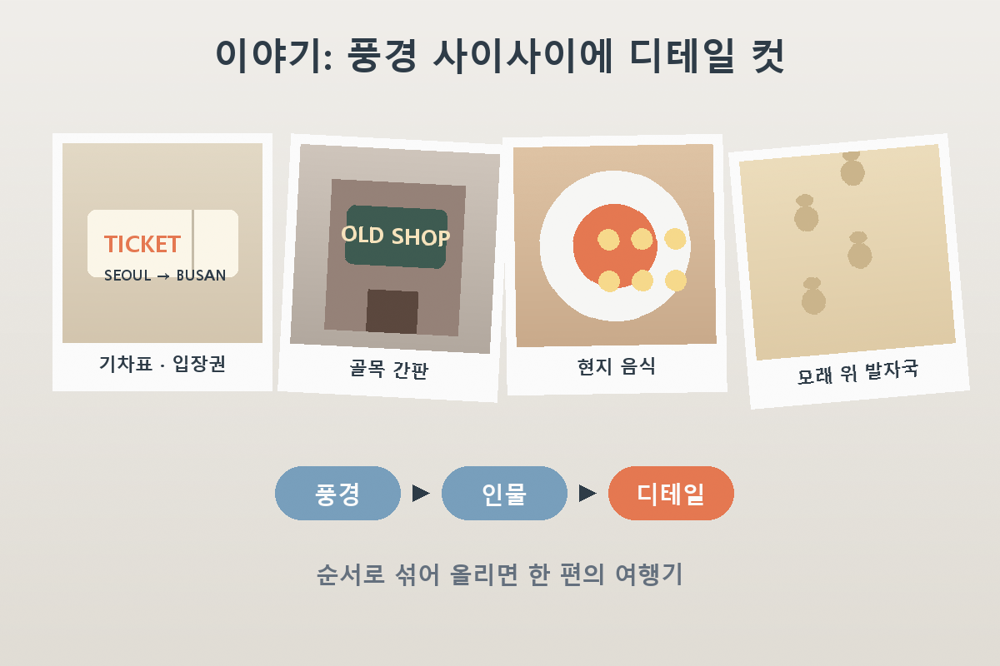

<!-- category: 스마트폰 사진 팁 -->
# 여행 사진 잘 찍는 법, 스마트폰으로 풍경과 인물 모두 살리는 3가지 팁

<!-- 제목 후보
1. 여행 사진 잘 찍는 법, 스마트폰으로 풍경과 인물 모두 살리는 3가지 팁  ← 선택
2. 여행지 사진 팁, 관광지 인증샷을 작품 사진으로 바꾸는 스마트폰 촬영법
3. 스마트폰 여행 사진, 사람 많은 명소에서도 예쁘게 찍는 요령
-->

## 서론

여행에서 돌아와 사진첩을 열어 보면, 분명 그 자리에서는 숨이 멎을 만큼 멋졌던 풍경이 사진 속에서는 밋밋하게 남아 있을 때가 많죠. 또 명소마다 사람이 가득해서 인증샷 한 장 건지기도 쉽지 않고요. 요즘은 여행 사진을 SNS에 올리고 앨범으로 남기는 분들이 많아서, 여행 준비물 목록에 '사진 잘 찍는 법'을 함께 챙기는 분들도 늘었어요. 그런데 여행 사진에는 다른 사진과 다른 고민이 있어요. 넓은 풍경과 사람을 한 장에 함께 담아야 하고, 시간과 장소를 마음대로 고를 수 없다는 점이에요. 오늘은 무거운 카메라 없이 스마트폰 하나로 여행지의 풍경과 인물을 모두 살리는 세 가지 팁, 시간, 구도, 그리고 이야기를 담는 방법을 알려드릴게요.

## 본론

### 1. 시간: 이른 아침과 해 질 녘에 명소 찍기

여행 사진의 절반은 '언제 찍느냐'로 결정돼요. 유명한 명소일수록 한낮에는 관광객이 몰려서 배경이 복잡해지고, 햇빛도 머리 위에서 강하게 내리쬐어 그림자가 진하고 색이 바래 보여요. 그래서 꼭 남기고 싶은 장소는 해가 뜬 직후 이른 아침에 찾아가 보세요. 사람이 거의 없어서 풍경을 온전히 담을 수 있고, 낮게 깔린 햇빛이 건물과 골목에 부드러운 입체감을 만들어 줘요. 아침이 어렵다면 해 지기 한 시간 전을 노려 보세요. 하늘과 풍경이 따뜻한 색으로 물들어서 같은 장소도 전혀 다른 분위기로 보여요. 여행 전날 밤 지도 앱으로 일출과 일몰 시간을 확인하고, 가장 찍고 싶은 장소 한두 곳만 그 시간에 배치해 두면 일정을 크게 바꾸지 않고도 좋은 사진을 얻을 수 있어요.

### 2. 구도: 인물은 작게, 풍경은 크게

여행 인증샷에서 가장 흔한 실수는 인물을 화면 가운데에 크게 세우는 거예요. 그러면 정작 '어디에 갔는지'가 잘 보이지 않아요. 풍경이 주인공인 장소에서는 반대로 인물을 작게, 풍경을 크게 담아 보세요. 격자를 켜고 인물을 화면 아래쪽 3분의 1 지점에 세우면 하늘과 산, 바다가 넉넉하게 들어와서 여행지의 분위기가 그대로 전해져요. 길이나 다리, 해변의 물결선처럼 화면 안쪽으로 이어지는 선이 있다면 그 선이 인물을 향하게 배치해 보세요. 보는 사람의 시선이 자연스럽게 인물에게 모여요. 사람이 많아서 배경을 비우기 어려울 때는 휴대폰을 낮게 들고 하늘 쪽을 올려 찍으면 복잡한 사람들을 화면 밖으로 밀어낼 수 있어요. 광각 렌즈 모드가 있다면 함께 써 보세요.

### 3. 이야기: 풍경 사이사이에 디테일 컷 남기기

마지막 팁은 '이야기'예요. 풍경과 인증샷만 가득한 사진첩은 시간이 지나면 어디가 어디였는지 헷갈리기 쉬워요. 그래서 큰 풍경 사이사이에 작은 디테일 컷을 함께 남겨 두는 걸 추천해요. 기차표나 입장권, 골목의 오래된 간판, 처음 먹어 본 현지 음식, 모래 위에 남은 발자국처럼 그날의 기억을 떠올리게 하는 작은 장면들이요. 이런 사진은 가까이 다가가서 배경을 단순하게 찍으면 충분해요. 이동 중인 기차 창밖이나 숙소 창가 풍경도 좋은 이야깃거리가 돼요. 이렇게 모은 사진을 나중에 풍경, 인물, 디테일 순서로 섞어서 올리면 한 편의 여행기처럼 흐름이 생겨요. 하루에 디테일 컷 다섯 장 남기기처럼 작은 목표를 정해 두면 여행이 끝났을 때 훨씬 풍성한 기록이 남아요.

## 결론

오늘 소개한 여행 사진 팁을 정리해 볼게요. 꼭 찍고 싶은 명소는 사람이 적고 빛이 부드러운 이른 아침이나 해 질 녘에 찾아가기, 인물은 작게 풍경은 크게 담고 길과 선으로 시선을 이끌기, 풍경 사이사이에 그날을 기억하게 할 디테일 컷 남기기. 이 세 가지만 기억해도 여행 사진첩이 훨씬 생생해질 거예요. 무거운 카메라를 챙기지 않아도 괜찮아요. **스마트폰 하나로도 감성 사진은 충분하다**는 것, 여행지에서 가장 크게 느끼실 수 있을 거예요. 지담 스튜디오도 여행을 떠날 때면 휴대폰 하나만 들고 이 순서대로 찍어 본답니다. 다음 여행지는 어디로 정하셨나요? 댓글로 알려 주시면 그 장소에 맞는 촬영 팁도 함께 고민해 볼게요. 이웃추가로 다음 글도 함께해 주세요!

---

#여행사진 #여행사진잘찍는법 #스마트폰사진 #폰카꿀팁 #여행스냅 #풍경사진 #인생샷 #골든아워 #여행기록 #감성사진 #지담스튜디오
