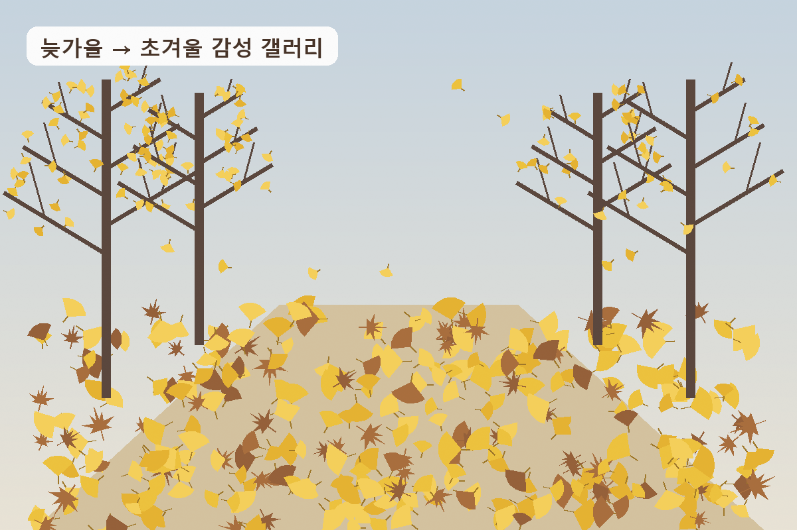
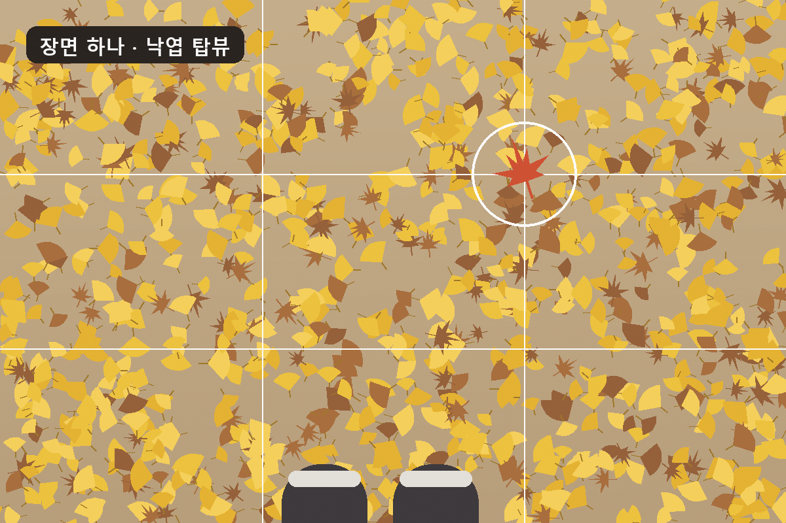
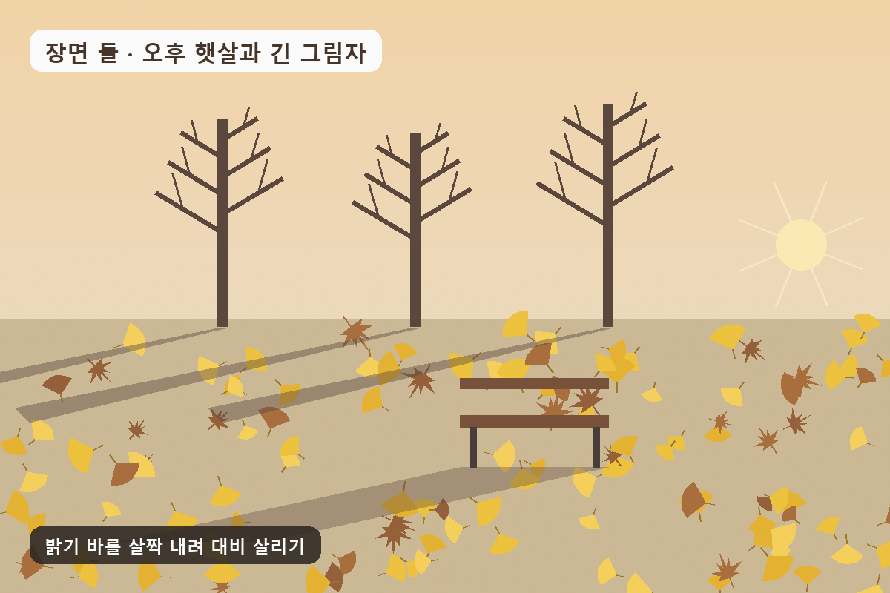
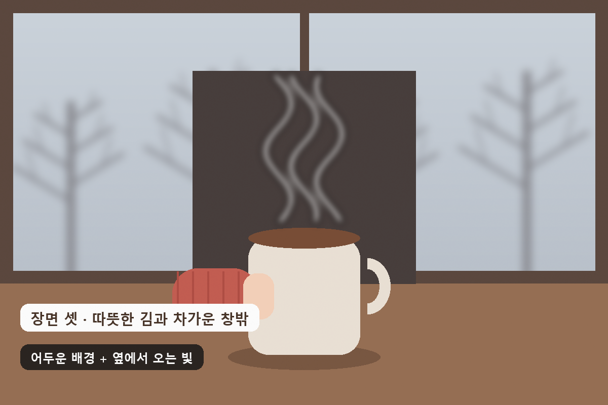

<!-- category: 감성 사진 갤러리 -->
# 늦가을 감성 사진, 초겨울로 넘어가는 지금 스마트폰으로 담기 좋은 장면 3가지

<!-- 제목 후보
1. 늦가을 감성 사진, 초겨울로 넘어가는 지금 스마트폰으로 담기 좋은 장면 3가지  ← 선택
2. 가을 끝자락 사진 찍는 법, 낙엽·입김·창가 햇살로 완성하는 계절 감성
3. 계절 감성 사진 갤러리, 11월에만 찍을 수 있는 장면 모음
-->

## 서론

단풍이 절정을 지나고 아침저녁으로 찬 바람이 불기 시작하면, 왠지 사진 찍을 거리가 줄어든 것 같다고 느끼시나요? 화려한 단풍철이 끝나면 휴대폰 카메라도 잠시 쉬게 되는 분들이 많아요. 그런데 사실 가을과 겨울 사이, 계절이 바뀌는 이 짧은 시기에만 볼 수 있는 장면들이 있어요. 바닥을 가득 덮은 낙엽, 낮게 깔리는 오후 햇살, 따뜻한 음료에서 피어오르는 김, 차가운 공기 속 입김처럼요. 요즘 SNS에서도 '늦가을 감성', '초겨울 무드' 같은 계절 사진이 꾸준히 사랑받고 있죠. 이번 감성 사진 갤러리에서는 지금 바로 나가서 스마트폰으로 담기 좋은 장면 세 가지를 골라, 장면마다 어떻게 찍으면 좋은지 함께 정리해 봤어요.

## 본론

### 1. 장면 하나: 바닥을 덮은 낙엽, 위에서 내려다보기

늦가을 길 위에는 은행잎과 단풍잎이 카펫처럼 깔려 있죠. 이 장면은 멀리서 찍기보다 휴대폰을 바닥 쪽으로 향하게 들고 위에서 내려다보는 '탑뷰'로 담으면 색감이 훨씬 풍성하게 살아나요. 화면 가득 낙엽만 채우면 그 자체로 계절이 느껴지는 패턴 사진이 되고, 화면 아래쪽 가장자리에 신발 끝을 살짝 넣으면 '내가 걷고 있는 길'이라는 이야기가 생겨요. 노란 은행잎 사이에 빨간 단풍잎 하나처럼 색이 다른 잎이 있다면 그 잎을 3분할 교차점에 두고 찍어 보세요. 시선이 자연스럽게 모여요. 햇빛이 강한 한낮보다는 흐린 날이나 해가 기운 오후가 낙엽의 색을 더 부드럽고 진하게 보여 줘요. 보정할 때 채도를 너무 올리기보다 따뜻함을 살짝 더하는 쪽이 자연스러워요.

### 2. 장면 둘: 낮게 깔리는 오후 햇살과 긴 그림자

이 계절에는 해가 일찍 지고 하루 종일 낮은 각도로 비치기 때문에, 오후 서너 시만 되어도 그림자가 길게 늘어져요. 이 긴 그림자가 늦가을 사진의 숨은 주인공이에요. 공원 벤치, 앙상해진 나무, 산책하는 사람의 그림자가 바닥에 길게 드리워진 모습을 찾아보세요. 해를 등지거나 옆에 두고 서서 그림자가 화면 안쪽으로 뻗어 가게 찍으면 공간에 깊이감이 생겨요. 이때 밝기 조절 바를 살짝 내리면 햇살이 닿은 부분과 그림자의 대비가 또렷해져서 차분하고 쓸쓸한 계절의 분위기가 잘 살아나요. 나뭇가지 사이로 햇빛이 새어 나오는 장면이라면 해를 가지 뒤에 살짝 숨기듯 찍어 보세요. 빛이 별처럼 갈라지며 반짝이는 느낌을 담을 수 있어요.

### 3. 장면 셋: 따뜻한 음료의 김과 차가운 창밖

날씨가 차가워질수록 실내의 따뜻함이 더 소중하게 느껴지죠. 카페나 집 창가에서 김이 모락모락 피어오르는 따뜻한 음료를 찍어 보세요. 포인트는 김이 잘 보이게 하는 거예요. 김은 어두운 배경 앞에서, 그리고 옆이나 뒤에서 빛이 비칠 때 가장 선명하게 보여요. 창가에서 컵을 빛 쪽에 두고, 창을 비스듬히 바라보며 찍으면 하얀 김이 빛을 받아 또렷하게 떠올라요. 음료를 막 받았을 때가 김이 가장 많으니 휴대폰을 미리 준비해 두세요. 창밖의 흐린 하늘이나 앙상한 나무가 흐릿하게 함께 담기면 '밖은 춥고 안은 따뜻한' 초겨울의 대비가 한 장에 담겨요. 니트 소매나 손으로 컵을 감싼 모습을 함께 넣으면 온기가 더 잘 전해져요.

## 결론

이번 갤러리에서 소개한 늦가을 장면을 다시 정리해 볼게요. 바닥을 덮은 낙엽은 위에서 내려다보며 색이 다른 잎 하나에 시선을 모으기, 낮게 깔린 오후 햇살과 긴 그림자로 공간의 깊이 담기, 따뜻한 음료의 김은 어두운 배경과 옆에서 오는 빛으로 또렷하게 찍기. 화려한 단풍철이 지나도 계절은 여전히 사진 찍을 거리를 건네주고 있어요. **스마트폰 하나로도 감성 사진은 충분하다**는 말처럼, 출퇴근길이나 산책길에서도 충분히 담을 수 있답니다. 지담 스튜디오도 요즘 오후 햇살이 길게 들어오는 시간을 기다렸다가 창가 사진을 찍곤 해요. 여러분이 이번 가을에 남긴 가장 좋아하는 한 장은 어떤 장면인가요? 댓글로 들려주세요. 다음 갤러리에서는 첫눈 오는 날의 장면으로 찾아올게요. 이웃추가로 함께해 주세요!

---

#늦가을사진 #가을감성 #초겨울 #계절사진 #낙엽사진 #감성사진갤러리 #스마트폰사진 #폰카꿀팁 #11월 #감성사진 #지담스튜디오
