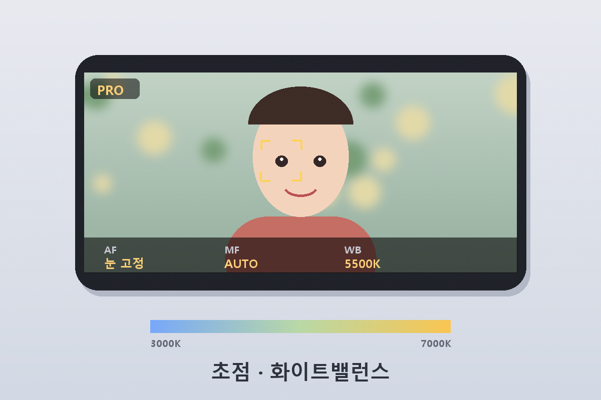
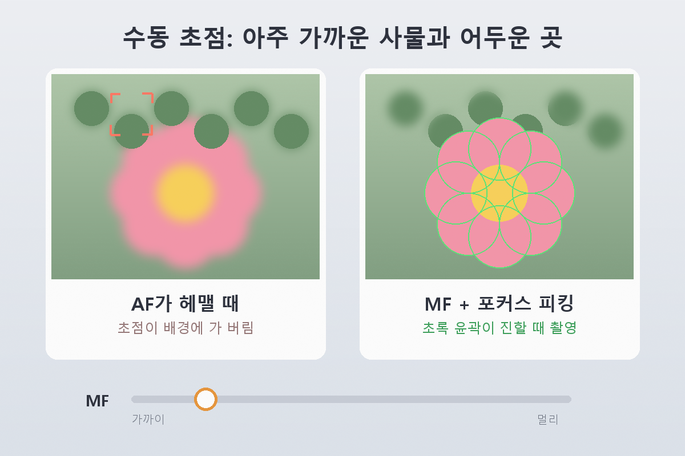

<!-- category: 카메라 촬영 기초 -->
# 카메라 초점과 화이트밸런스 기초, 스마트폰 프로 모드로 선명하고 정확한 색 담기

<!-- 제목 후보
1. 카메라 초점과 화이트밸런스 기초, 스마트폰 프로 모드로 선명하고 정확한 색 담기  ← 선택
2. 사진이 흐리고 색이 이상할 때, 초점과 화이트밸런스부터 확인하세요
3. 카메라 촬영 기초 2편, 초점 고정과 색온도를 스마트폰으로 쉽게 배우기
-->

## 서론

지난 카메라 촬영 기초 글에서는 셔터 속도, ISO, 조리개로 이루어진 노출의 3요소를 함께 살펴봤어요. 밝기를 원하는 대로 맞출 수 있게 됐다면, 이제 사진의 완성도를 좌우하는 다음 두 가지를 알아볼 차례예요. 바로 '초점'과 '화이트밸런스'예요. 분명 잘 찍은 것 같은데 막상 확대해 보니 주인공이 흐릿했던 경험, 실내 조명 아래에서 찍은 사진이 유난히 누렇거나 파랗게 나와서 당황했던 경험 있으시죠? 이 두 가지 문제는 대부분 초점과 화이트밸런스를 카메라에게만 맡겼을 때 생겨요. 오늘은 스마트폰 프로 모드를 활용해 원하는 곳에 정확히 초점을 맞추는 방법과, 눈으로 본 색 그대로 담는 화이트밸런스 조절법을 차근차근 알려드릴게요.

## 본론

### 1. 초점: 눌러서 맞추고, 길게 눌러 고정하기

스마트폰은 보통 화면 가운데나 얼굴처럼 보이는 곳에 자동으로 초점을 맞춰요. 그런데 내가 강조하고 싶은 곳과 카메라가 고른 곳이 다를 때가 많아요. 가장 기본은 '주인공을 직접 누르기'예요. 화면에서 선명하게 담고 싶은 부분을 손가락으로 한 번 누르면 그곳에 초점이 맞춰져요. 인물 사진이라면 얼굴보다 '눈'을 누르는 게 좋아요. 눈이 선명하면 나머지가 조금 흐려도 사진 전체가 또렷해 보이거든요. 그다음으로 꼭 알아 둘 기능이 '초점 고정'이에요. 화면을 길게 누르면 AE/AF 잠금 같은 표시가 뜨면서 초점과 밝기가 고정되는데, 이 상태에서는 구도를 살짝 바꾸거나 피사체가 움직여도 초점이 엉뚱한 곳으로 옮겨 가지 않아요. 같은 장면을 여러 장 찍을 때 특히 유용해요.

### 2. 수동 초점: 아주 가까운 사물과 어두운 곳에서

자동 초점이 자주 헤매는 상황이 있어요. 꽃잎이나 물방울처럼 아주 가까운 사물을 찍을 때, 그리고 밤이나 어두운 실내처럼 빛이 부족할 때예요. 이럴 때 프로 모드의 'MF(수동 초점)'를 써 보세요. MF 슬라이더를 움직이면 초점이 가까운 곳에서 먼 곳으로 이동하는데, 화면에서 원하는 부분이 가장 또렷해지는 지점에서 멈추면 돼요. 많은 스마트폰에는 '포커스 피킹' 기능이 있어서, 초점이 맞은 부분의 윤곽을 초록색이나 빨간색으로 표시해 줘요. 이 표시가 주인공 위에 가장 진하게 나타날 때 셔터를 누르면 실패가 거의 없어요. 접사를 할 때는 렌즈와 사물 사이 최소 거리가 있어서 너무 가까우면 초점이 맞지 않아요. 한 뼘 정도 떨어졌다가 천천히 다가가며 맞춰 보세요. 손떨림을 줄이려면 팔꿈치를 테이블에 붙이는 것도 도움이 돼요.

### 3. 화이트밸런스: 조명에 맞춰 색온도 바꾸기

화이트밸런스는 '흰색을 흰색으로 보이게' 맞추는 기능이에요. 우리 눈은 조명이 바뀌어도 흰 종이를 흰색으로 알아보지만, 카메라는 조명의 색을 그대로 담아요. 그래서 노란 백열등 아래에서는 사진이 누렇게, 그늘이나 흐린 날에는 푸르스름하게 나오죠. 프로 모드의 WB 메뉴에서 색온도 숫자(K)를 바꿔 보세요. 숫자가 낮을수록 사진이 푸르게, 높을수록 노랗게 보정돼요. 대략 백열등이나 노란 실내 조명은 3000K 안팎, 형광등은 4000K 안팎, 맑은 낮 햇빛은 5500K 안팎, 흐린 날이나 그늘은 6500K 안팎으로 맞추면 자연스러운 색에 가까워져요. 가장 쉬운 방법은 화면 안의 흰 컵이나 종이가 하얗게 보일 때까지 숫자를 천천히 움직이는 거예요. 반대로 노을의 따뜻함을 더 살리고 싶다면 일부러 숫자를 높여 분위기를 연출할 수도 있답니다.

## 결론

오늘 배운 내용을 정리해 볼게요. 초점은 주인공, 특히 눈을 직접 눌러 맞추고 길게 눌러 고정하기, 아주 가까운 사물이나 어두운 곳에서는 수동 초점과 포커스 피킹 활용하기, 화이트밸런스는 조명에 맞춰 색온도를 바꾸고 흰 물체가 하얗게 보이는지 확인하기. 지난번에 배운 노출의 3요소와 오늘의 초점, 화이트밸런스까지 익히면 카메라의 기본기는 모두 갖춘 셈이에요. 이 원리는 어떤 카메라를 쓰든 똑같이 적용돼요. 그래서 **스마트폰 하나로도 감성 사진은 충분하다**는 말처럼, 프로 모드만으로도 충분히 연습할 수 있어요. 지담 스튜디오도 촬영 전에 꼭 흰 물체로 색을 먼저 확인하는 습관이 있답니다. 따라 해 보다 헷갈리는 부분이 있다면 댓글로 질문 남겨 주세요. 이웃추가로 다음 기초 글도 함께해요!

---

#카메라기초 #초점 #화이트밸런스 #색온도 #수동초점 #포커스피킹 #프로모드 #스마트폰사진 #사진입문 #사진공부 #지담스튜디오
