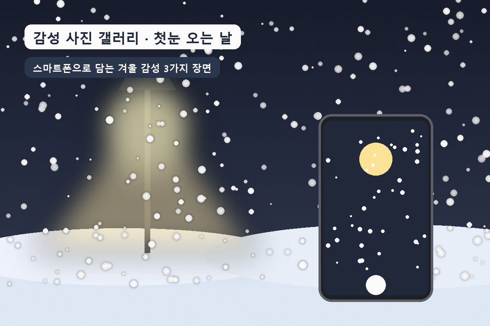
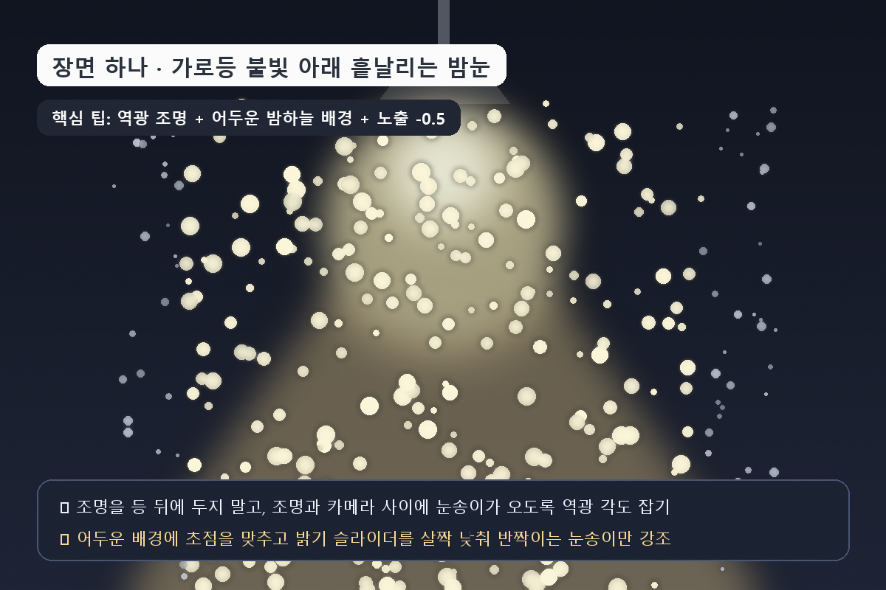
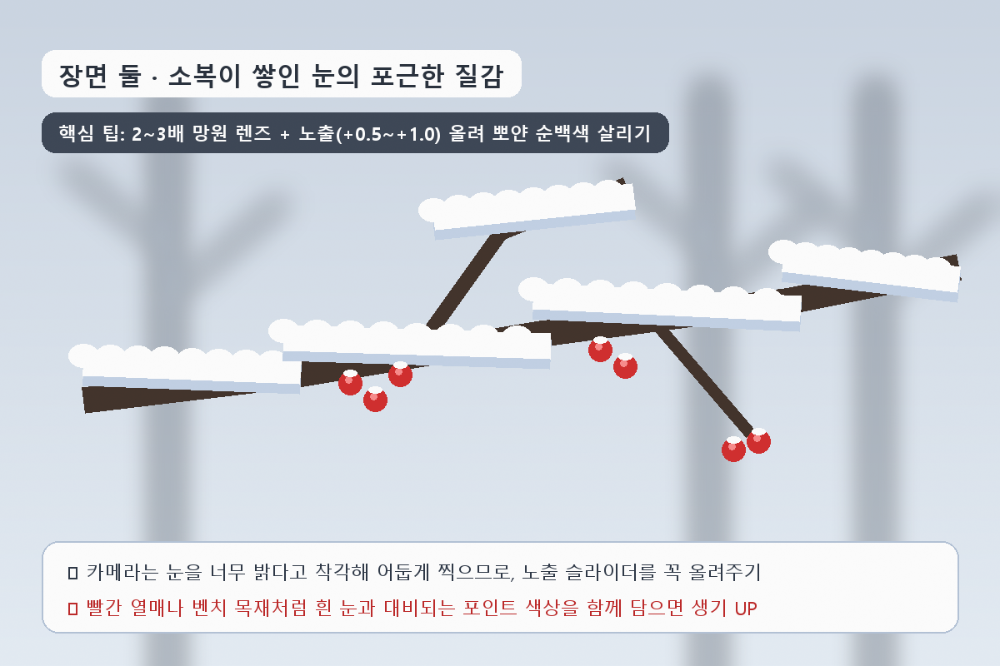
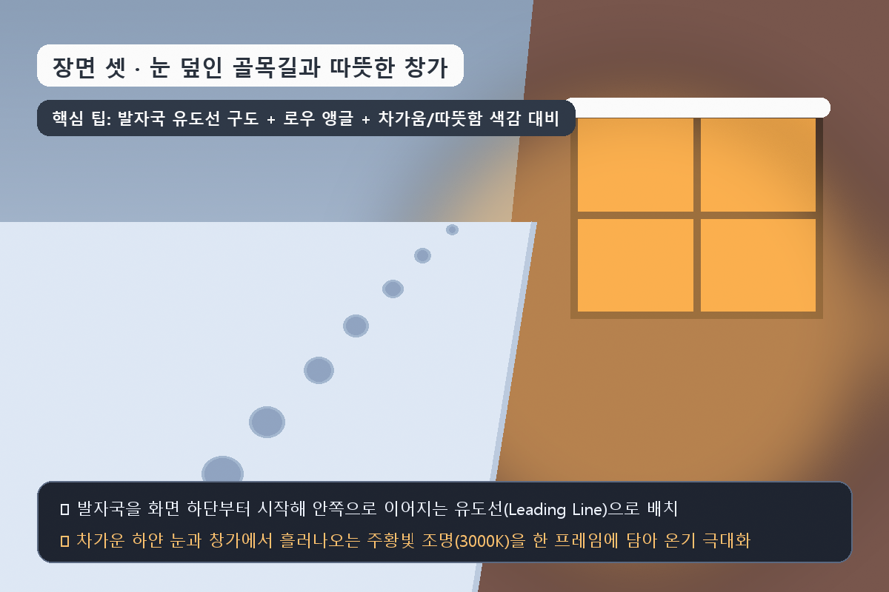

<!-- category: 감성 사진 갤러리 -->
# 첫눈 오는 날 감성 사진, 스마트폰으로 담기 좋은 겨울 장면 3가지 갤러리

<!-- 제목 후보
1. 첫눈 오는 날 감성 사진, 스마트폰으로 담기 좋은 겨울 장면 3가지 갤러리  ← 선택
2. 첫눈 오는 날 사진 찍는 법, 흩날리는 눈·소복한 디테일·따뜻한 골목길
3. 감성 사진 갤러리, 첫눈 내리는 날 스마트폰으로 남기는 감성 컷 3가지
-->

## 서론

지난 늦가을 감성 갤러리 글 마지막에 약속드렸던 대로, 이번에는 겨울의 시작을 알리는 첫눈 장면을 모아 돌아왔어요. 창밖으로 하얀 눈송이가 하나둘 떨어지기 시작하면 누구나 설레는 마음으로 휴대폰을 꺼내 들게 되죠. 하지만 막상 셔터를 눌러 보면 눈송이는 온데간데없이 사라지고 흐릿한 회색 하늘만 찍히거나, 하얀 눈이 칙칙하게 뭉개져 실망했던 적이 한 번쯤 있으실 거예요. 눈은 빛을 반사하는 성질이 강하고 끊임없이 움직이기 때문에, 작은 촬영 요령 몇 가지만 알고 있어도 사진의 완성도가 완전히 달라져요. 이번 감성 사진 갤러리에서는 비싼 카메라 없이 스마트폰 하나만으로 첫눈의 설렘을 영화 속 한 장면처럼 담을 수 있는 세 가지 대표 장면과 구체적인 팁을 소개해 드릴게요. 올해 첫눈이 내리는 날, 망설이지 말고 바로 따라 해 보세요.

## 본론

### 1. 장면 하나: 가로등 불빛 아래 흩날리는 밤눈

하늘에서 흩날리는 눈송이를 가장 드라마틱하게 담는 순간은 바로 어둠이 내린 저녁이에요. 낮에 밝은 하늘을 배경으로 찍으면 하얀 눈이 하늘에 묻혀 잘 보이지 않지만, 밤에는 어두운 배경 덕분에 눈송이의 윤곽이 또렷하게 드러나거든요. 여기서 가장 중요한 포인트는 '역광 조명'을 찾는 것이에요. 가로등이나 가게 간판 불빛 바로 아래로 가셔서, 조명을 등지는 것이 아니라 조명과 내 스마트폰 사이에 눈송이가 오도록 카메라 각도를 잡아 보세요. 빛을 등 뒤에서 받는 눈송이가 림라이트(Rim Light)처럼 가장자리를 환하게 빛내며 보석처럼 쏟아져 내려요. 이때 화면의 초점을 불빛 바로 옆 어두운 허공에 맞추고 밝기 슬라이더를 살짝 아래로 내려 주면, 배경은 더욱 짙은 밤으로 가라앉고 빛나는 눈송이만 감성적으로 강조된답니다.

### 2. 장면 둘: 나뭇가지와 벤치 위에 소복이 쌓인 눈의 디테일

눈이 펑펑 내린 직후나 눈이 그친 이른 아침에는 멀리 있는 풍경보다 발밑과 주변의 작은 사물에 시선을 돌려 보세요. 앙상한 나뭇가지, 공원 벤치, 자전거 안장 위에 소복하게 얹힌 눈은 차분하면서도 포근한 겨울 특유의 질감을 보여 줘요. 이 장면을 찍을 때는 스마트폰 기본 렌즈 대신 2배나 3배 망원 렌즈를 켜고 다가가 보세요. 왜곡 없이 눈의 부드러운 결정이 살아나고 뒷배경이 자연스럽게 흐려지면서 분위기가 훨씬 깊어져요. 특히 주의할 점은 노출 보정이에요. 스마트폰 카메라는 하얀 눈을 보면 너무 밝다고 판단해 사진 전체를 칙칙한 회색으로 어둡게 찍으려는 버릇이 있어요. 초점을 맞춘 뒤 화면의 해 아이콘을 살짝 위로 올려 노출을 +0.5~+1.0 정도 밝게 맞춰 주면 눈 본연의 뽀얗고 맑은 순백색이 그대로 살아나요.

### 3. 장면 셋: 눈 덮인 골목길의 첫 발자국과 따뜻한 창가 온기

아직 아무도 밟지 않은 새하얀 골목길에 남겨진 첫 발자국은 사진에 따뜻한 이야기와 여운을 더해 주는 훌륭한 소재예요. 발자국이 화면 맨 아래에서 시작해 저 멀리 골목 안쪽이나 불 켜진 창가로 이어지도록 구도를 잡아 보세요. 이 발자국이 자연스러운 '시선 유도선'이 되어 보는 사람의 시선을 프레임 안쪽으로 깊숙이 이끌어 줘요. 휴대폰을 어른 눈높이에서 내려 무릎이나 허리 높이에서 찍으면 원근감이 살아나 눈길이 더 길고 아늑하게 느껴져요. 여기에 골목길 카페나 주택 창문에서 새어나오는 따뜻한 주황빛 전구 조명을 함께 프레임 한쪽에 걸쳐 담아 보세요. 차가운 하얀 눈과 따스한 실내 불빛의 색감 대비가 어우러지면서, 추운 겨울날 마음까지 포근해지는 감성 스냅이 완성돼요.

## 결론

이번 갤러리에서 소개한 첫눈 오는 날의 세 가지 장면을 다시 정리해 볼게요. 가로등 역광과 어두운 밤하늘을 이용해 흩날리는 눈송이를 보석처럼 담기, 2~3배 망원 렌즈와 노출 올리기로 소복한 눈의 뽀얀 질감 살리기, 첫 발자국의 유도선과 창가 주황빛 불빛으로 차가움과 따뜻함의 대비 완성하기. 첫눈은 잠깐 내렸다가 금세 녹아 사라지지만, 그 순간을 정성껏 담은 사진 한 장은 겨울 내내 따뜻한 기억으로 남아 줘요. 비싼 카메라나 거창한 장비가 없어도 괜찮아요. **스마트폰 하나로도 감성 사진은 충분하다**는 사실은 첫눈 오는 날에도 변함없이 통하니까요. 지담 스튜디오도 올해 첫눈 소식이 들리면 카메라를 들고 골목길로 나가 볼 생각이에요. 여러분이 올겨울 첫눈이 오면 가장 먼저 렌즈에 담고 싶은 장면은 무엇인가요? 댓글로 편하게 들려주세요. 이웃추가도 잊지 마세요!

---

#첫눈 #첫눈오는날 #겨울사진 #감성사진 #눈사진 #눈오는날 #스마트폰사진 #폰카팁 #겨울감성 #감성사진갤러리 #지담스튜디오
